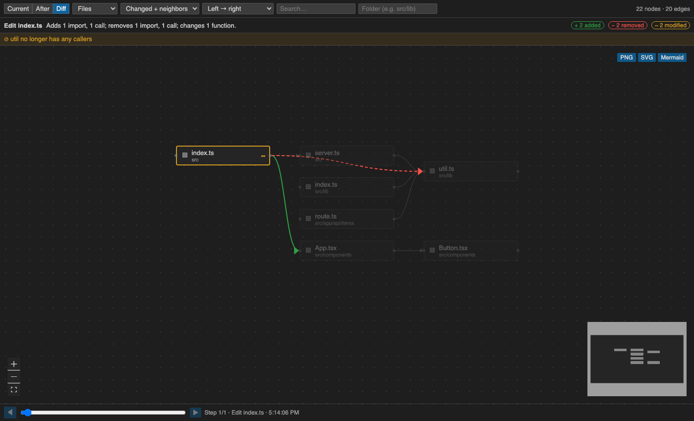
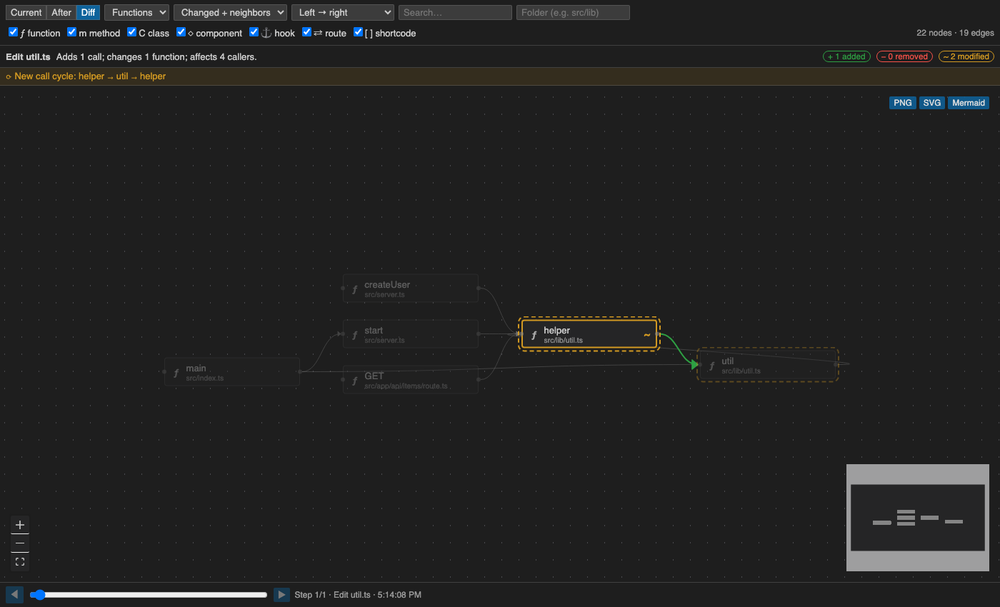
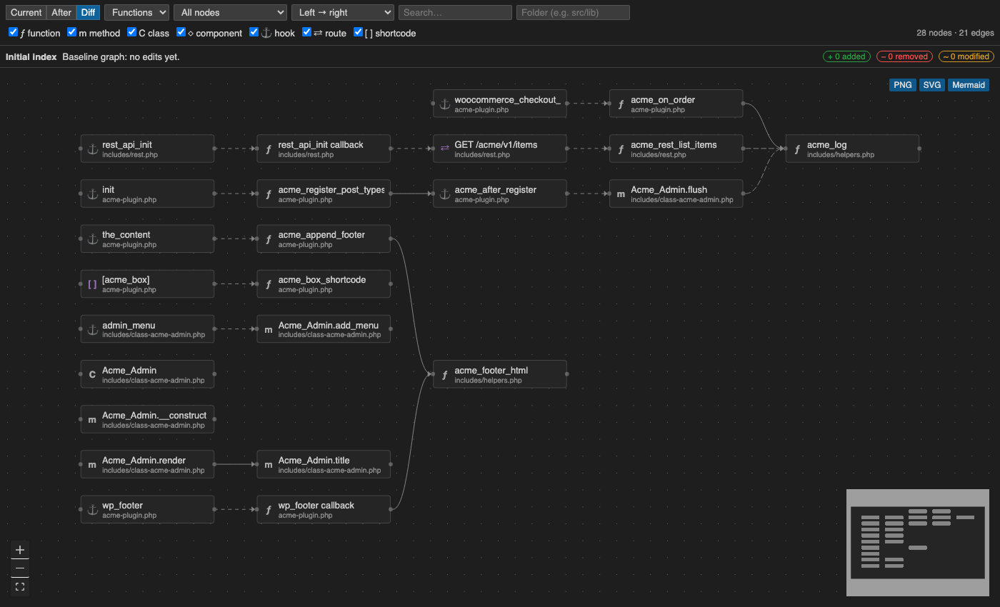
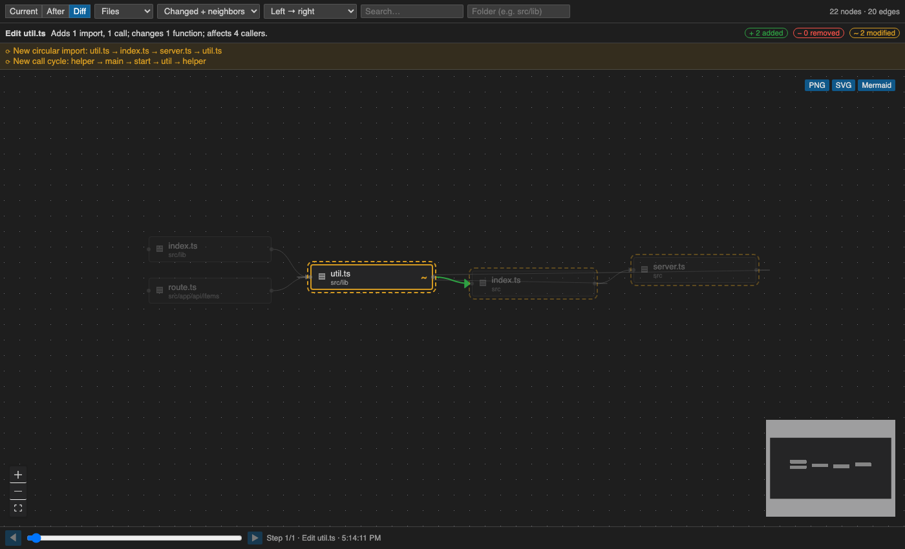

# FlowLens

See what your AI agent just changed, and what that change does to your app's flow, in real time.

FlowLens watches edits (from Claude Code hooks, or any save / file change), keeps a live **file graph** and **call graph** of your workspace, and shows the **before → after diff** of that graph: added in green, removed in red, modified in amber. When Claude Code proposes an edit, FlowLens previews the graph change **before the file is written**.



Everything runs locally. No telemetry and no network calls, with one opt-in exception: **✨ Explain with AI** sends the code of the block you clicked to your AI provider, and only when you click it.

## What you get

| | |
|---|---|
| **Edit Feed** (Activity Bar → FlowLens) | Every edit with file, `+/−` lines, changed ranges, touched functions, grouped by agent session. Click to open the diff. |
| **Gutter highlights** | Recently edited lines are highlighted and fade out over time. |
| **Graph panel** (`FlowLens: Open Panel`) | Files or Functions level; **Current / After / Diff** modes; scope "Changed + neighbors" or "All"; left-right, top-down or clustered-by-folder layout; search and folder filter. Click a node to jump to the code. |
| **Simple mode** (on by default) | Files used by 5+ others (`utils`, `auth`, `ui/button`…) keep their block but drop their incoming lines and show a **⇠N** badge; files with no lines go in a grid below. Hover or click any block to light up all its lines and fade the rest. Changed lines are never hidden. |
| **What this file does** | Click a block: the details panel shows the file's (or function's) own header/doc comment, plus what FlowLens can tell from the code: Next.js page/layout/API route and its URL, `'use client'`/`'use server'`, routes handled, and the main things it defines. Computed locally, no AI call. |
| **✨ Explain with AI** (opt-in) | Button in the details panel: a 1–2 sentence explanation of the file or function from an AI model. Default: OpenRouter's free models (`openrouter/free`). Run **FlowLens: Set AI API Key** once (stored in VS Code secret storage; `OPENROUTER_API_KEY` env var also works). Change `flowlens.ai.baseUrl` / `flowlens.ai.model` for Gemini, Ollama (fully local) or any OpenAI-compatible API. Explanations are cached and marked *(code changed since)* when the file changes. |
| **Show flow of…** | Searchable dropdown of every function, method, class, hook and route. Pick one to see only its flow: what it calls (depth 1–5 or all) plus its direct callers. Also via **Show flow** in the node details. |
| **Open anywhere** | `↗ Browser` opens the live graph in your default browser (Chrome etc.) on `127.0.0.1` with a secret token; `⧉ New window` pops it into its own VS Code window. Clicking a node in the browser still jumps to the code in VS Code. |
| **What the agent did** | Every changed block shows a one-line summary, e.g. *Claude Code: added save, changed load* (*(proposed)* while the edit is pending). |
| **Instructions for the AI** | Click a block → **📝 Instructions for the AI**, e.g. *"If you change this, also update the cache. Don't add dependencies."* When Claude Code edits that file, the hook hands your notes to Claude so it checks its edit against them. Blocks with notes show 📝. |
| **Pending preview** | Claude Code's proposed `Edit`/`Write` is applied in memory; the diff appears while the agent waits, and is dropped if the edit is rejected or fails. |
| **Framework flows** | WordPress `add_action`/`add_filter`/`do_action`, shortcodes, REST routes (WooCommerce hooks flagged); Express and Next.js route handlers; Flask/FastAPI routes. |
| **Insights** | New circular imports, new call cycles, functions that lost all callers, calls to functions that were removed. |
| **Time scrubber** | Step back through every edit and see the graph diff at that point. |
| **Export** | PNG, SVG or Mermaid of exactly what is visible. |





Languages: JavaScript, TypeScript/TSX, PHP, Python (parsed with tree-sitter, compiled to WebAssembly, so no native build tools are needed).

## Install

```bash
npm install
npm run package          # builds flowlens.vsix
code --install-extension flowlens.vsix
```

Or press **F5** in this folder to run it in an Extension Development Host.

## Connect Claude Code

1. Open your project in VS Code.
2. Run **FlowLens: Install Claude Code Hooks**. This adds `PreToolUse`, `PostToolUse`, `PostToolUseFailure`, `PermissionDenied` and `Stop` hooks to `.claude/settings.local.json` in each workspace folder. Your existing hooks are kept, and the file is backed up first.
3. Start a **new** Claude Code session in that folder. AI edits now show as *Claude Code* in the feed, with a pending preview before each edit lands.

The hook runs a tiny Node script that forwards the event to FlowLens on `127.0.0.1` with a per-session token. It prints nothing (except your 📝 notes for the file being edited), always exits 0, and gives up after 0.7 s, so it can't block or slow the agent. If VS Code isn't open, it just exits. **FlowLens: Remove Claude Code Hooks** removes only the FlowLens entries.

Other agents (Copilot, Cursor, …) still show up through the file-change fallback, labelled *manual*.

## Commands

| Command | |
|---|---|
| FlowLens: Open Panel | Graph panel |
| FlowLens: Open Graph in Browser | Live graph in your web browser (local only) |
| FlowLens: Open Graph in New Window | Graph panel in a separate VS Code window |
| FlowLens: Install / Remove Claude Code Hooks | See above |
| FlowLens: Re-index Workspace | Rebuild the graph from disk |
| FlowLens: Set AI API Key | Key for **Explain with AI** (empty = remove) |
| FlowLens: Clear Edit History | Empty the feed (and drop any pending preview) |

## Settings

| Setting | Default | |
|---|---|---|
| `flowlens.excludeFolders` | `node_modules`, `vendor`, `dist`, `build`, `.git`, `wp-includes`, `wp-admin`, `.claude`, … | Folder names ignored for tracking and indexing |
| `flowlens.indexOnStartup` | `true` | Index the workspace graph at startup |
| `flowlens.maxNodes` | `1500` | Nodes rendered at once (changed nodes are kept first) |
| `flowlens.snapshotLimit` | `50` | Graph history kept for diff and scrubber |
| `flowlens.ai.baseUrl` | `https://openrouter.ai/api/v1` | OpenAI-compatible API for Explain with AI (user settings only) |
| `flowlens.ai.model` | `openrouter/free` | Model id |
| `flowlens.decorationFadeSeconds` | `60` | How long edited-line highlights last |

## Good to know

- **Static analysis.** Calls are resolved by name and import proximity. Dashed edges are medium/low confidence. Dynamic dispatch and string-built hook names aren't followed.
- **Before text.** Files FlowLens hasn't seen yet (not indexed, never opened) produce a first entry with *before unknown*. Indexing fills these baselines in.
- **History is in memory.** Snapshots are not kept across VS Code restarts.
- **Excludes are folder names.** `.gitignore` isn't read.

## Development

```bash
npm run build             # esbuild (extension) + Vite (webview)
npm run watch
npm run typecheck && npm run lint
npm test                  # vitest: extractors (golden graphs), differ, preview, insights, hooks
npm run test:integration  # real VS Code: feed, hooks via the forwarder, index, diff timing, preview
npm run test:vsix         # same suite against the packaged .vsix
```

See `ARCHITECTURE.md` for the design and `CLAUDE.md` for conventions. CI runs on Ubuntu and Windows.
